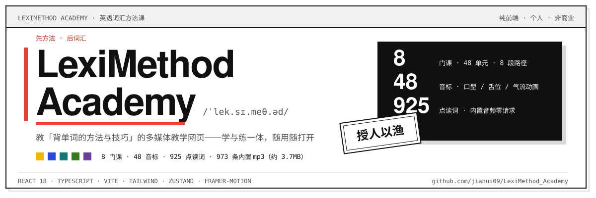
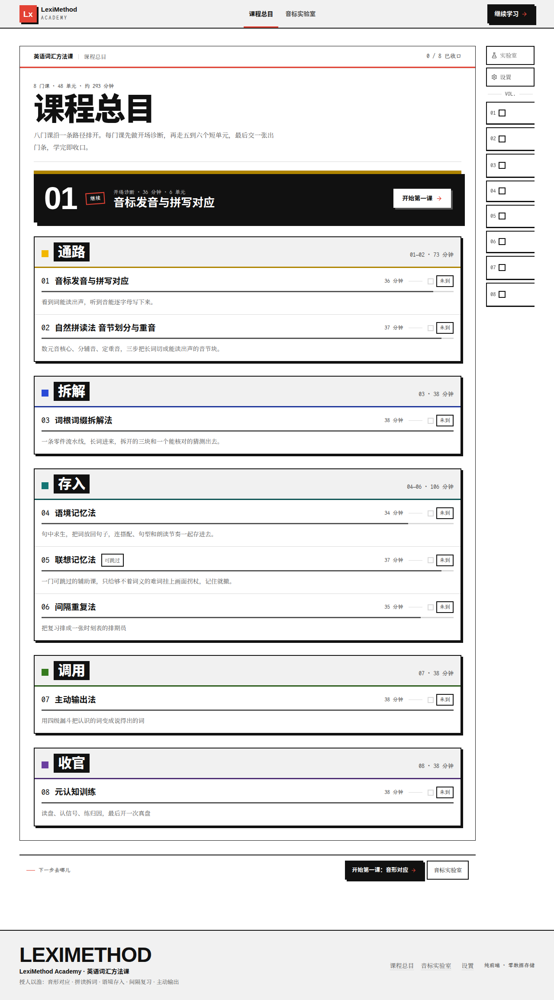
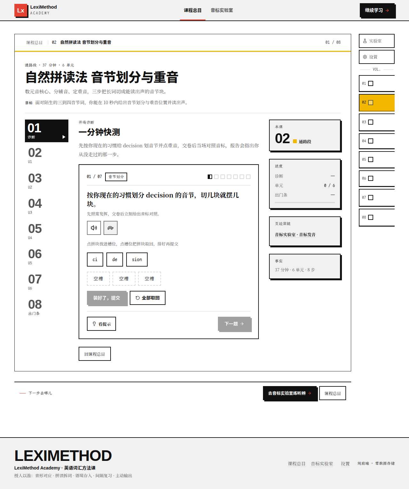
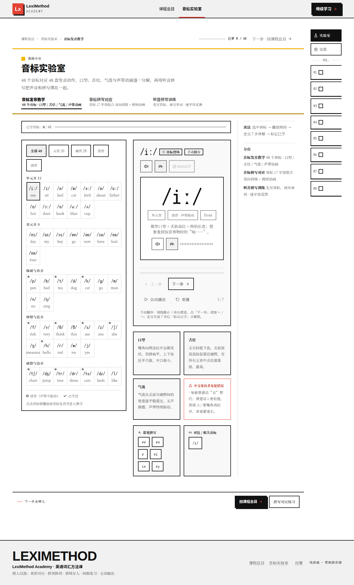

# LexiMethod Academy

<p align="center"></p>

**一个教「背单词的方法与技巧」的多媒体教学网页。** 大多数人卡在「背单词」上，缺的其实是方法：怎么把声音和拼写对上，怎么把长词拆开，怎么把词存进长时记忆，又怎么在忘掉之前把它调出来。这个站点把这套方法做成 **8 门可交互的课程**，学与练一体、随用随打开。

- **不需要登录、不上传任何数据**：进度默认保存在你自己的浏览器里（`localStorage`），可在设置页一键清除或整体关闭
- **离线发音**：48 个音标与 925 个点读词全部内置 mp3，运行时零外部请求
- **纯静态产物**：构建后是一个 `dist` 目录，可部署到任意静态托管（Cloudflare Pages）

## 界面

<table>
  <tr>
    <td width="50%"></td>
    <td width="50%"></td>
  </tr>
  <tr>
    <td width="50%"></td>
    <td></td>
  </tr>
</table>

设计语言为瑞士国际主义 × 新狂野主义：全出血白纸地、海报级 Helvetica 题名、2px 粗描边与 4/8px 硬偏移影、状态印章、指路红与五段路径色，规范见 [DESIGN.md](DESIGN.md)。

## 功能地图

| 路由 | 内容 |
| --- | --- |
| `/` | 重定向到 `/methods` |
| `/methods` | 课程总目：8 门课沿五段路径排开，进度默认存本机（可关可清） |
| `/methods/:id` | 8 门课分步教学：自然拼读法、音标发音与拼写对应、词根词缀拆解、联想记忆、语境记忆、间隔重复、主动输出、元认知训练（旗舰课 8 步动画讲解） |
| `/lab/phonemes` | 音标发音教学：48 音标口型 / 舌位 / 气流 / 声带动画 + 7 步分步教学 |
| `/lab/mapping` | 音标 ⇄ 字母组合双向训练 + 规则动画 |
| `/lab/dictation` | 听音拼写训练：先写音标再写单词，逐字母反馈 |
| `/settings` | 设置：口音、动画档位、音效、语速，以及学习数据的本机存储开关 |

> **已削减**：训练（`/practice`）、复习（`/review`）、实战演练（`/analyze`）、费曼关（`/feynman`）、工具箱（`/toolbox`）、统计（`/stats`）与学习地图首页均已移除，全站只保留**方法课程**与**音标实验室**两块内容（课程内练习环节与实验室训练保留）。

## 核心特性

- **离线发音音频**：48 个音标本体 + **925 个可点读词**（例词、词族、词缀例词、题库、音节块等 8 个数据源的词全集）均为**同源内置 mp3**（48kbps 美式音色，piper 神经 TTS 生成），浏览器语音合成只作句子级兜底——运行时**零外部请求**
- **口音边界**：离线点读音（音标 + 例词 mp3）固定是**美音**，不受设置页「口音」开关影响；设置里的口音只作用于句子级 TTS 兜底（音色随操作系统/浏览器而变），课程正文 IPA 为英式体例。标音英式、音频美式的差异与两者切换规则见 [NOTICE-AUDIO.md](NOTICE-AUDIO.md) 的「口音边界」
- **数据只在本机**：学习进度与错题本只写浏览器 `localStorage`（`leximethod.*` 三个键），设置页可一键清除或关闭存储；**一律不上行、不追踪、不发外部请求**
- **可检验的交互策略**：题目首击锁定、交卷才揭晓；答错先强制归因，再「合上答案」重测一轮，重测只留痕、不改首答成绩；诊断成绩驱动分数带分流，主行动直接指向你该去的单元
- **质量底线门禁**：对比度 ≥4.5:1、字号 ≥12px、触控 ≥44×44、每页 1 h1、无重复 id，逐路由审计并并入 `npm run verify`
- **路由错误边界**：懒加载失败或渲染崩溃自动降级（重试 / 刷新 / 回课程），不白屏

## 技术栈

React 18 · TypeScript · Vite 7 · Tailwind 3 · zustand（`localStorage` 持久化开关）· framer-motion（`useMotionTier` 门控的持续动效）· piper-tts（离线音频生成，仅构建期）

## 快速开始

```bash
npm install
npm run dev        # http://127.0.0.1:5173
```

首次打开即可从课程总目进入第一课；离线音频已随仓库内置，无需额外生成步骤。

## 命令一览

| 命令 | 作用 |
| --- | --- |
| `npm run dev` / `build` / `preview` | 开发 / 产出 `dist` / 本地预览产物 |
| `npm run verify` | **总门禁**：build + 体积 + 数据验收 + 音频门禁 + 底线审计 |
| `npm run size` | 首屏 <200KB、CSS <30KB、全量站点 <4.5MB（音频点击时才拉取） |
| `npm run check:data` | 源数据一致性（3933 项断言） |
| `npm run check:audio` | 音频三方核验：词全集 ↔ manifest ↔ 磁盘（48 + 925，可解码、时长/体积预算、无孤儿） |
| `npm run audit:floor` | 逐路由设计底线审计（对比度 / 字号 / 触控 / h1 / id） |
| `npm run smoke` / `npm run accept` | 浏览器冒烟 / 验收（需先 `npm run dev`，依赖系统 Chromium，可用 `CHROME_BIN` 覆盖） |

## 离线音频再生成

```bash
npm run gen:audio -- --setup   # 首次：建 .venv-audio + 下载模型（校验 md5）
npm run gen:audio              # 增量：只合成缺失文件
npm run gen:audio -- --force   # 全量重建（换音色/换模型后必须）
```

产出 `public/audio/` + `src/data/phonemeAudio.ts`（生成物，勿手改）。音色、许可（模型 MIT / Lessac 研究许可 / 个人非商业）与复现细节见 [NOTICE-AUDIO.md](NOTICE-AUDIO.md)。

## 部署（Cloudflare Pages）

- 构建命令 `npm run build`，输出目录 `dist`，纯 SPA（深链由 Pages 的 SPA 回退接管）
- 免费额度（2 万文件 / 25MB 单文件）远大于本项目（约 990 个文件、全量 ≈4.0MB）
- **音频或静态资源变更后需重新触发一次部署**才会生效
- 上线后回归：`node scripts/audit-floor.mjs <url>` + `npm run smoke -- <url>` + `LEXI_BASE=<url> npm run accept`

## 目录速览

```
src/
  pages/        路由页面（懒加载，RouteErrorBoundary 兜底）
  components/   ui / layout / phonics / course / lab / demos
  data/         课程、音标、词表、题库等静态数据（tsc 类型校验 + check:data 验收）
  hooks/        useSpeech（离线音频优先 + TTS 兜底）等
  lib/audioBus  片段元素池 + 声源互斥
  store/        zustand（进度 / 复习 / 设置）+ localStorage 持久化层
scripts/        门禁与生成器（verify / smoke / accept / gen:audio …）
public/audio/   离线发音音频（生成物）
docs/assets/    README 用标题图与截图
```

## 文档

- [DESIGN.md](DESIGN.md)：设计契约（规范性）
- [docs/ui-rebuild-contracts.md](docs/ui-rebuild-contracts.md)：动效、图标与交互策略的落地契约
- [docs/content-style-guide.md](docs/content-style-guide.md)：课程文案体例（标点、用语、事实规范）
- [docs/curriculum-outline-v1.md](docs/curriculum-outline-v1.md)：8 门课课程大纲
- [NOTICE-AUDIO.md](NOTICE-AUDIO.md)：音频来源与许可边界

## 贡献

欢迎提 Issue 与 Pull Request。约定：

- 一个 PR 只包含一类修改；提交前确保 `npm run verify` 全绿
- 文案遵循 [docs/content-style-guide.md](docs/content-style-guide.md)；界面与动效改动对齐 [docs/ui-rebuild-contracts.md](docs/ui-rebuild-contracts.md)
- 涉及 UI 的改动附修改前后截图

## 许可与声明

本项目为**个人非商业用途**，不提供任何 SLA；课程内容整理自公开的学习方法论并注明出处。音频资产的来源与许可边界见 [NOTICE-AUDIO.md](NOTICE-AUDIO.md)。
